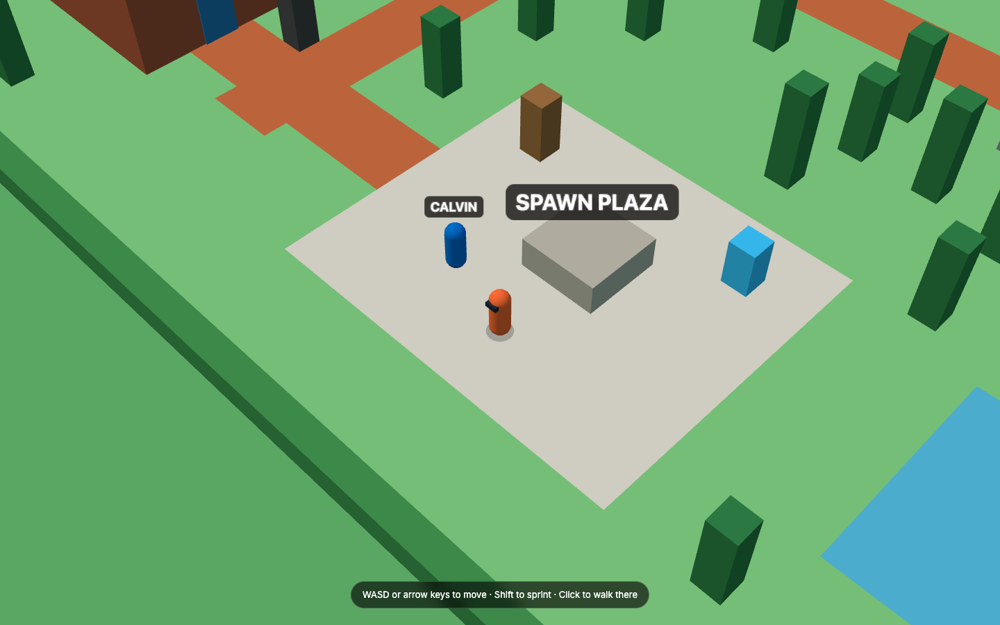
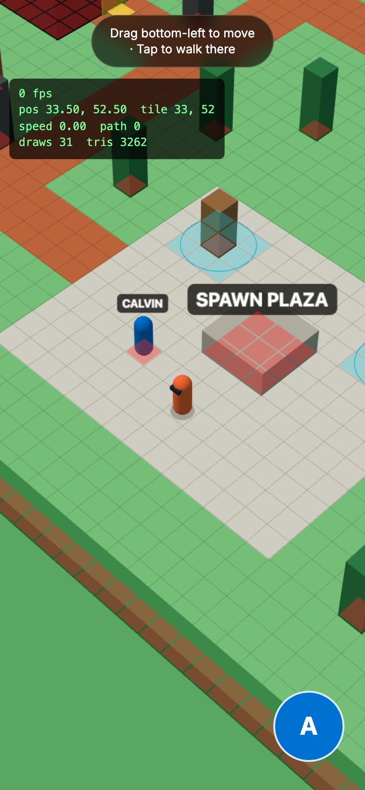

# MyPark World: Progress Log

Plan: [mypark-world-plan.md](mypark-world-plan.md). All world work is on the `world` branch. `main` still serves the classic site.

## Status

| # | Milestone | State |
|---|---|---|
| M0 | Project setup | Done (Nov 15, 2026). Waiting on Calvin: switch Pages source to GitHub Actions |
| M1 | Graybox movement ★ | Built, tests green. **Waiting on Calvin's phone review** |
| M2–M8 | | Not started |

## How to run

```
npm install          # once
npm run dev          # http://localhost:5173
npm run dev:lan      # same, plus a LAN URL for phone testing (same Wi-Fi)
npm run build        # typecheck + production build into dist/
npm test             # Vitest (grid, collision, pathfinding, map checks)
npm run test:e2e     # Playwright smoke tests, desktop 1440x900 + mobile 390x844
npm run assets       # optimize models listed in scripts/assets.manifest.json into public/models/
```

Phone preview: run `npm run dev:lan`, open the `Network:` URL it prints on a phone on the same Wi-Fi.
URL knobs: `?debug=1` (grid, collision cells, interact radii, FPS), `?yaw=0` (square the camera to the map), `?zoom=1.3` (pull the camera back 30%).

---

## M0: Project setup (done)

**On `main`**
- `.github/workflows/deploy.yml`: copies `index.html`, `style.css`, `script.js`, `assets/`, and a `.nojekyll` into `_site/` and deploys only that folder. `docs/`, `CLAUDE.md`, and everything else are never uploaded. Runs on push to `main` and on manual dispatch.
- Until the Pages source is switched to GitHub Actions, this workflow's deploy step fails (expected) and the old branch deploy keeps serving the site.

**On `world`**
- Vite 5.4.21 + TypeScript 5.9.3 (strict) + three.js 0.187.0. Vitest 3.2.7, Playwright 1.65.1, `@gltf-transform/cli` 4.5.1. All pinned exact.
- Classic site moved to `public/classic/` (with its `assets/`), served at `/classic/`. Verified by a Playwright test: page loads, no broken images, no failed requests.
- `.github/workflows/ci.yml`: build + unit tests + smoke tests on every push to a non-`main` branch. Never deploys.
- `npm run assets` pipeline in place (meshopt + WebP). Manifest is empty until M2. The CLI was verified on a Kenney building: 120 KB to 20 KB.
- `CLAUDE.md` updated for the new stack.

## M1: Graybox movement ★ (ready for review)

**What's in**
- Gray-box exterior, 80 x 60 tiles, every area at its planned position: four gyms up the west side, Spawn Plaza, Workshop, Blacktop with track loop, Calvin's Court (fenced, two openings), hedged edges, 60 placeholder trees.
- Capsule player. Walk 4 u/s, sprint 6.5 u/s, about 80ms to full speed.
- Keyboard: WASD / arrows, normalized diagonals, Shift sprints.
- Touch: joystick spawns under the thumb in the bottom-left zone (left 45%, bottom 50%), analog walk on a light push, sprint past 85%. The base drags along if the thumb goes past the rim.
- Click / tap-to-move: A* on the grid with string-pulling. A blocked target (building, tree) retargets to the nearest open tile on the side facing the player.
- Collision: circle vs grid, axis-separated, slides along walls, sub-stepped so nothing tunnels.
- Camera: perspective, 30° FOV, 50° down, 45° yaw, critically damped follow (0.15s) with a small lead. Clamped to map bounds. Portrait phones auto zoom out. Buildings between camera and player fade to 30%.
- Debug overlay at `?debug=1`.
- A button (touch only), safe-area aware. Nothing to interact with until M3, so it only pulses and buzzes.

**Tests**
- Vitest: 13 passing (collision, sliding, no tunneling, A*, string-pulling, every door and area reachable from spawn, map fully enclosed).
- Playwright: 16 passing across desktop and mobile (boot with zero console errors, debug overlay, click/tap-to-move, blocked-target retarget, keyboard walk/sprint/stop, wall slide, diagonal speed, joystick walk/sprint/release, A button placement, classic site).

**Screenshots**

| Desktop 1440x900 | Mobile 390x844 |
|---|---|
|  |  |
|  |  |

**What Calvin should judge on his phone**
1. Joystick: does it land where your thumb expects, and is the 85% sprint threshold right? (My read: most thumbs rest at the rim, so you'll sprint almost all the time. Raising it or making sprint a toggle are both cheap.)
2. Speed: walk 4, sprint 6.5. Too slow to cross the map, or about right?
3. Camera: default 45° yaw vs `?yaw=0`. At 45° the main path runs diagonally on screen, so on a keyboard you hold two keys to follow it. Also try `?zoom=1.3`.
4. Tap-to-move: does the route it picks look sane, and is auto-sprint on long trips welcome?
5. Collision: scrape along the fountain, the gyms, and the court fence. Anything sticky?

---

## Decisions and deviations from the plan

Defaults I picked where the plan was ambiguous or didn't fit. Flag any you want reversed.

| Topic | Plan said | What I did | Why |
|---|---|---|---|
| Vitest version | Vitest (unpinned) with Vite 5 | Vitest 3.2.7 | Vitest 5 requires Vite 6+. 3.2.7 is the newest line that supports Vite 5 |
| TypeScript version | TypeScript (strict) | 5.9.3, not 7.x | 7 is a new major. 5.9 is the safe choice with the rest of the toolchain |
| three.js version | r165+, pinned | 0.187.0 for the world. Classic keeps 0.165.0 from its CDN import map | Classic is frozen as-is |
| Classic asset paths | "Fix its asset paths to `/classic/assets/...` or a shared `/images/`" | Moved `assets/` to `public/classic/assets/`. Classic's relative paths work with zero edits | The classic files stay byte-identical. The world gets its own optimized copies in `public/images/` at M3 |
| Joystick | nipplejs or custom | Custom (in `src/engine/input.ts`) | One less dependency, and the spawn-under-thumb zone rule is easier to own |
| Tap-to-move speed | Not specified | Walks, auto-sprints when the trip is over 12 units | Crossing an 80-tile map at walk speed by tap is a slog |
| Camera tuning | Fixed 45° yaw | 45° default, plus `?yaw=` and `?zoom=` knobs | So the M1 feel review can compare options without a rebuild |
| Pond | "hedges, water, or fences" at edges | Added a small pond east of the plaza | Fills the empty south-middle. Easy to cut |
| Skip link | "Skip to résumé" | Points at `/classic/` for now | `/resume` doesn't exist until M7 |
| `.nojekyll` | Include in the artifact | Included, with `include-hidden-files: true` | `upload-pages-artifact` v4+ drops dotfiles by default |
| `deploy.yml` on `world` | Changed to build + `dist/` at M8 | Left as the M0 version for now | It only triggers on `main`, so it's inert here. Swapped at M8 as planned |

## Open issues

- **LAN preview not verified from this laptop.** The dev server listens on all interfaces, but a connection from the laptop to its own LAN IP times out. The laptop runs CrowdStrike, FortiClient, and Tailscale network extensions, and one of them may filter LAN traffic. If the phone can't load the LAN URL, the plan's fallback is a temporary `cloudflared` tunnel (not installed here).
- **Pushing the M0 workflow also pushed commit `2d8ae5d`** (CLAUDE.md, this plan, `.gitignore`), which was local-only. Until the Pages source is switched to GitHub Actions, the branch deploy serves `/docs/mypark-world-plan.md` and `/CLAUDE.md` at the site URL. Switching the source fixes it.
