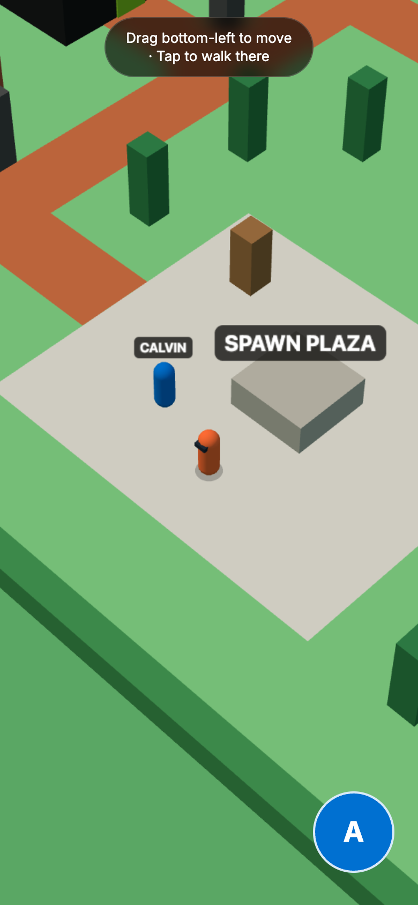
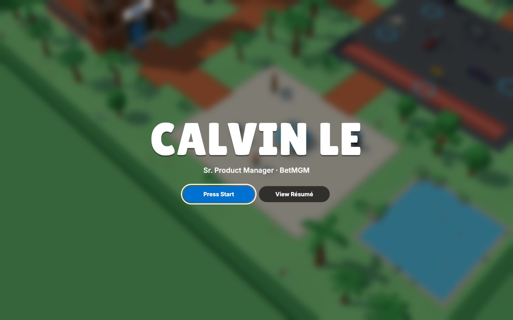
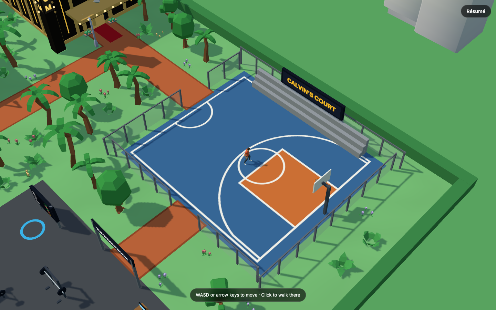
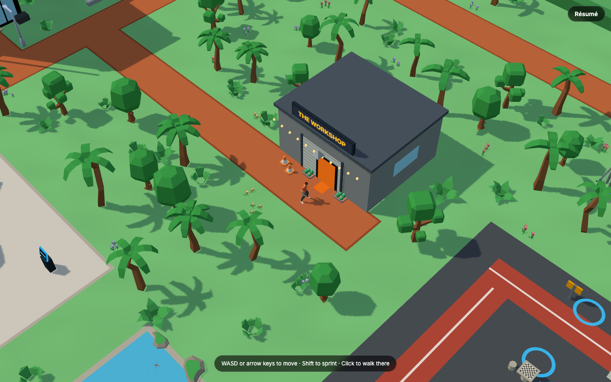
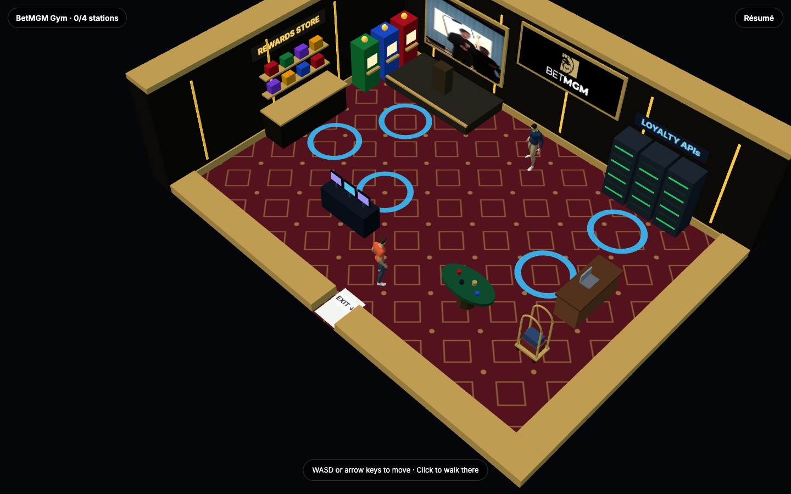
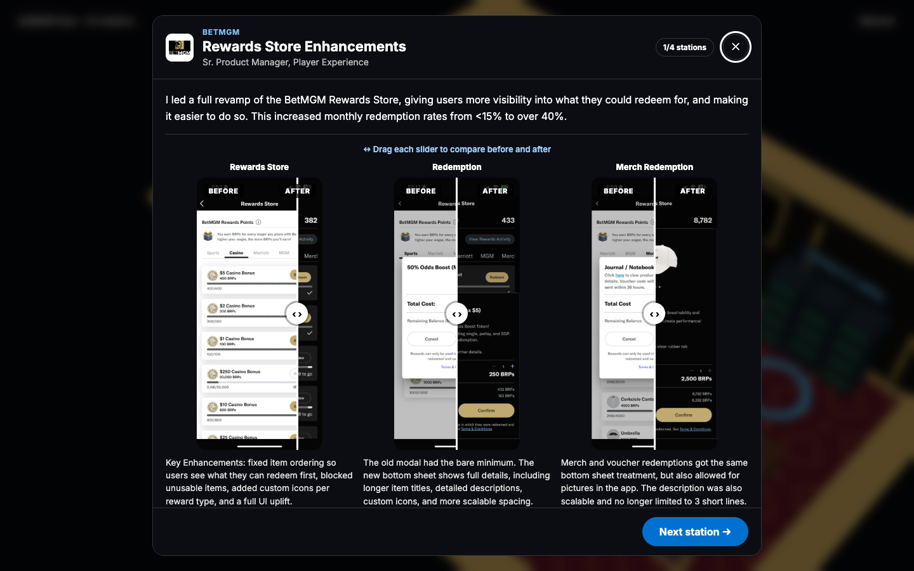
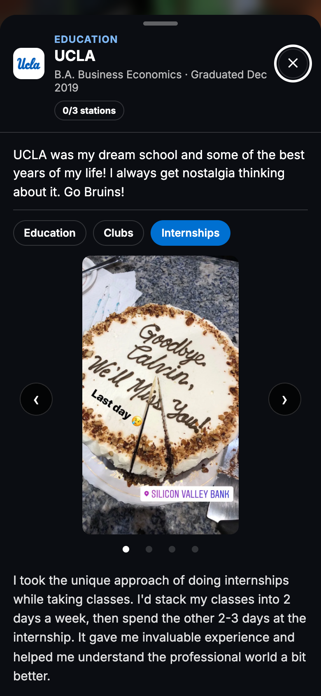

# MyPark World: Progress Log

Plan: [mypark-world-plan.md](mypark-world-plan.md). All world work is on the `world` branch. `main` still serves the classic site.

## Status

| # | Milestone | State |
|---|---|---|
| M0 | Project setup | Done (Nov 15, 2026). Pages source switched to GitHub Actions and verified: only site files are served |
| M1 | Graybox movement ★ | Done. Approved by Calvin on his phone (Nov 15, 2026) |
| M2 | Exterior art pass | Done, with small items deferred (see M2 section) |
| M3 | Interaction + dialogue + cards ★ | Built, tests green. **Waiting on Calvin's review** |
| M4–M8 | | Not started |

## How to run

```
npm install          # once
npm run dev          # http://localhost:5173
npm run dev:lan      # same, plus a LAN URL for phone testing (same Wi-Fi)
npm run build        # typecheck + production build into dist/
npm test             # Vitest (grid, collision, pathfinding, map checks)
npm run test:e2e     # Playwright smoke tests, desktop 1440x900 + mobile 390x844
npm run assets       # optimize models listed in scripts/assets.manifest.json into public/models/
```

Phone preview: run `npm run dev:lan`, open the `Network:` URL it prints on a phone on the same Wi-Fi.
URL knobs: `?debug=1` (grid, collision cells, interact radii, FPS), `?yaw=0` (square the camera to the map), `?zoom=1.3` (pull the camera back 30%).

---

## M0: Project setup (done)

**On `main`**
- `.github/workflows/deploy.yml`: copies `index.html`, `style.css`, `script.js`, `assets/`, and a `.nojekyll` into `_site/` and deploys only that folder. `docs/`, `CLAUDE.md`, and everything else are never uploaded. Runs on push to `main` and on manual dispatch.
- Until the Pages source is switched to GitHub Actions, this workflow's deploy step fails (expected) and the old branch deploy keeps serving the site.

**On `world`**
- Vite 5.4.21 + TypeScript 5.9.3 (strict) + three.js 0.187.0. Vitest 3.2.7, Playwright 1.65.1, `@gltf-transform/cli` 4.5.1. All pinned exact.
- Classic site moved to `public/classic/` (with its `assets/`), served at `/classic/`. Verified by a Playwright test: page loads, no broken images, no failed requests.
- `.github/workflows/ci.yml`: build + unit tests + smoke tests on every push to a non-`main` branch. Never deploys.
- `npm run assets` pipeline in place (meshopt + WebP). Manifest is empty until M2. The CLI was verified on a Kenney building: 120 KB to 20 KB.
- `CLAUDE.md` updated for the new stack.

## M1: Graybox movement ★ (approved)

**Calvin's review (Nov 15):** movement, speed, and collision are right. Changes made from his feedback:
- Joystick is now fixed bottom-left and always visible on touch: smaller and 40% opacity at rest, full size and opacity under the thumb. A touch within reach of the stick grabs it; taps anywhere else are tap-to-move.
- Camera pulled back about 28% (distance 36 to 46, portrait minimum width 13 to 17 units).
- The controls hint flashes until the visitor first moves (touch) or for 30s (desktop).

**What's in**
- Gray-box exterior, 80 x 60 tiles, every area at its planned position: four gyms up the west side, Spawn Plaza, Workshop, Blacktop with track loop, Calvin's Court (fenced, two openings), hedged edges, 60 placeholder trees.
- Capsule player. Walk 4 u/s, sprint 6.5 u/s, about 80ms to full speed.
- Keyboard: WASD / arrows, normalized diagonals, Shift sprints.
- Touch: fixed joystick bottom-left, analog walk on a light push, sprint past 85%.
- Click / tap-to-move: A* on the grid with string-pulling. A blocked target (building, tree) retargets to the nearest open tile on the side facing the player.
- Collision: circle vs grid, axis-separated, slides along walls, sub-stepped so nothing tunnels.
- Camera: perspective, 30° FOV, 50° down, 45° yaw, critically damped follow (0.15s) with a small lead. Clamped to map bounds. Portrait phones auto zoom out. Buildings between camera and player fade to 30%.
- Debug overlay at `?debug=1`.
- A button (touch only), safe-area aware. Nothing to interact with until M3, so it only pulses and buzzes.

**Tests**
- Vitest: 13 passing (collision, sliding, no tunneling, A*, string-pulling, every door and area reachable from spawn, map fully enclosed).
- Playwright: 16 passing across desktop and mobile (boot with zero console errors, debug overlay, click/tap-to-move, blocked-target retarget, keyboard walk/sprint/stop, wall slide, diagonal speed, joystick walk/sprint/release, A button placement, classic site).

**Screenshots**

| Desktop 1440x900 | Mobile 390x844 |
|---|---|
|  |  |
|  |  |

## M2: Exterior art pass (built, a few items open)

**What's in**
- Third-party files and licenses are logged in `docs/ASSETS.md` (all CC0).
- Asset pipeline (`npm run assets`): one scenery kit GLB (24 Kenney models, 110 KB), four trainers (65 to 73 KB each, about 4,500 triangles, one material), shared animations (118 KB, 6 clips), signage logos (62 KB). 492 KB of models total.
- Exterior art: UCLA (brick, twin towers), Deloitte (glass tower), Meta (white campus, rooftop logo), BetMGM (black and gold, chasing marquee bulbs), Workshop, Blacktop (track, chess tables, bench, trophy case, hoop), Calvin's Court (painted lines, chain-link fence, bleachers), fountain, résumé kiosk, palms, flowers, pond, skyline.
- Sun with soft shadows, sky fill, fog. Quality tiers (high / medium / low) picked on boot, with an automatic step down under 30fps. `?quality=low` forces one.
- Four trainer looks, animated (idle, walk, jog, sprint), sharing one skeleton and one animation file. A look is 8 palette colors, so outfits cost nothing extra to download.
- Loading screen, title screen, character select (arrows, swipe, Enter). The choice is saved, and returning visitors skip the title.
- Résumé button top-right (points at `/classic/` until `/resume` ships in M7).

**Measured**
- Draw calls: about 110 on high and medium, about 46 on low (budget: under 150).
- First playable download: about 0.85 MB uncompressed for JS + models (budget: 3 MB). JS is 192 KB gzipped.
- Tests: 13 unit, 22 smoke (desktop + mobile), including a tour that visits every area.

**Screenshots**

| | |
|---|---|
|  |  |
|  |  |
|  |  |
|  |  |

**Still open in M2**
- Frame rate on a real phone is unmeasured. Headless tests can't tell us; Calvin's phone can.
- Trainers have bare feet colored as shoes, and the base body is muscular. Real shoes and looser clothes need Blender modeling (planned for the M5 avatar pass).
- Gym exteriors are built in code (plus one Kenney tower), not from kit buildings. After Calvin asked for unique buildings (Nov 15), each got its own architecture: UCLA is Royce Hall (twin belfry towers, banded brick, three-arch portico, rose window, gabled nave), Deloitte is a corporate HQ (glass tower, glazed lobby, wordmark, green light lines), Meta is a tech campus (stacked volumes, roof garden, monument sign), BetMGM is a casino (marquee billboard, pylon sign, giant chip, red carpet, chasing bulbs).
- Stadium lights at the court and path footprint decals are not built.
- Trainer names (Rookie, Playmaker, Sixth Man, Sharpshooter) and loading tips are drafts for Calvin to review.

## M3: Interaction + dialogue + cards ★ (ready for review)

**What's in**
- **Content migrated:** all 11 career entries, bio, side builds, and hobbies now live in `src/content/`, verbatim. 52 card photos optimized to WebP: 79 MB of originals down to 4.4 MB.
- **Proximity prompts:** walk into range and a prompt floats over the thing ("E · Rewards Store" on desktop, "● Rewards Store" on touch). Nearest target in the direction you face wins. Click or tap a target and the player walks over and uses it.
- **Dialogue:** Pokémon-style box with a speaker tab, typewriter text, blinking ▼, and choices. E / Space / Enter / click / the A button advance. Esc skips.
- **Plaza Calvin:** on a first visit he walks up and starts the intro. Choices: "Show me around" (he leads you to the UCLA door), "I'll explore", "Who are you?" (About card with your two bio paragraphs).
- **Project cards:** every screen type from the classic site: before/after slider, side-by-side with zoom spot, single image with zoom spot, swipeable gallery, bullets, timeline, side photo, side gallery, jump links. Tap any photo for the lightbox. Desktop panel, full-screen sheet on phones (swipe the header down to close). Keyboard-usable modal with a focus trap.
- **BetMGM interior:** walk through the door (fade), four stations (Rewards Store counter, server racks, partnership desk with a bellhop cart, AI lab pod), the Product Summit stage showing your photo, and Calvin as gym leader. Rings turn from blue to green with a check when visited, a counter shows "2/4 stations", "Next station →" drops a bouncing arrow on the nearest unvisited one. Progress is saved.
- **Blacktop stations** (outdoors) are wired too: mile markers, chess tables, coach's bench, trophy case.
- Other gym doors say "Still under construction" until M4.

**Tests**
- Vitest: 13 passing. Playwright: 37 passing across desktop and mobile, including a full BetMGM run (enter, all four stations, leader, exit, reload) and a sweep that opens every station's card and checks every image loads.

**Screenshots**

| | |
|---|---|
|  |  |
|  |  |

**For Calvin to review**
1. Dialogue copy: every line is a draft, listed in `docs/CONTENT-EDITING.md`.
2. Cards on your phone: does the before/after slider feel right, and do the zoom spots land where you expect?
3. The BetMGM room: do the four stations read as what they are?

**Deferred from this milestone**
- Hover outline glow on interactables (desktop shows a pointer cursor for now).
- Gym leader outfits per era (every Calvin wears the plaza look until the M5 avatar pass).

### Calvin's M3 review (Nov 15) and what changed

1. **Desktop speed:** keyboard and mouse now always move at 7.5 units/s. No sprint key. Phone speeds are unchanged.
2. **Smaller park:** the map went from 80 x 60 to 52 x 60. Calvin's Court moved next to BetMGM at the top of the main path. The Workshop and the Blacktop merged into **The Weightroom**, one outdoor area between the plaza and the court with five stops: Sportsbook Ticker, Workbench, Sprint Lane (both marathons in one card), Chess Table, Hoop (all of basketball in one card). The second chess table, the coach's bench, the trophy case, the second mile marker, and the Workshop easter egg were cut so the area doesn't read as a brag list.
3. **Cards:**
   - Rewards Store shows its three before/afters together (a row on desktop, a swipeable row on phones) instead of behind tabs.
   - Loyalty APIs: "Account Linking" and "Real-Time Data" are one comparison with lettered A and B spots. Hover, click, or tap a letter to zoom in and swap the caption. Captions are unchanged.
   - Hints tell people what to do: "Drag the slider to compare before and after", "Tap A or B to zoom in".
   - Phone sheet: rounded top with a strip of the world above it, slides up with an iOS-style curve, follows the finger when dragged by the header, and springs back or slides away on release.
   - Photo props (Product Summit, Meta HQ) show smaller, framed, with a caption. The captions are placeholders for Calvin.
4. **Idle hint:** the how-to-move hint hides while moving and returns after 5 seconds of standing still.
5. **A button:** hidden by default on touch. It appears, translucent, only when there is something in range to use or a dialogue to advance.
6. **Dialogue:** shows "Press any key to continue" (desktop) or "Tap to continue" (touch), and any key continues.

---

## Decisions and deviations from the plan

Defaults I picked where the plan was ambiguous or didn't fit. Flag any you want reversed.

| Topic | Plan said | What I did | Why |
|---|---|---|---|
| Vitest version | Vitest (unpinned) with Vite 5 | Vitest 3.2.7 | Vitest 5 requires Vite 6+. 3.2.7 is the newest line that supports Vite 5 |
| TypeScript version | TypeScript (strict) | 5.9.3, not 7.x | 7 is a new major. 5.9 is the safe choice with the rest of the toolchain |
| three.js version | r165+, pinned | 0.187.0 for the world. Classic keeps 0.165.0 from its CDN import map | Classic is frozen as-is |
| Classic asset paths | "Fix its asset paths to `/classic/assets/...` or a shared `/images/`" | Moved `assets/` to `public/classic/assets/`. Classic's relative paths work with zero edits | The classic files stay byte-identical. The world gets its own optimized copies in `public/images/` at M3 |
| Joystick | nipplejs or custom; spawns where the thumb lands | Custom (in `src/engine/input.ts`), fixed position | One less dependency. Calvin preferred a fixed stick after testing on his phone |
| Tap-to-move speed | Not specified | Walks, auto-sprints when the trip is over 12 units | Crossing an 80-tile map at walk speed by tap is a slog |
| Camera tuning | Fixed 45° yaw | 45° default, plus `?yaw=` and `?zoom=` knobs | So the M1 feel review can compare options without a rebuild |
| Pond | "hedges, water, or fences" at edges | Added a small pond east of the plaza | Fills the empty south-middle. Easy to cut |
| Skip link | "Skip to résumé" | Points at `/classic/` for now | `/resume` doesn't exist until M7 |
| `.nojekyll` | Include in the artifact | Included, with `include-hidden-files: true` | `upload-pages-artifact` v4+ drops dotfiles by default |
| Before/after | "A before/after comparison slider" | Built as a slider (the classic site shows the two side by side) | The plan asked for it, and each before/after pair has matching dimensions, so the overlay lines up |
| Gym doors | Interact to enter | Walking onto the door tile enters, and so does the prompt | Feels like a Pokémon door. The prompt is there for click/tap and keyboard users |
| Map size and areas | 80 x 60 with a separate Workshop interior and Blacktop | 52 x 60 with one outdoor Weightroom | Calvin's call after M3: the court was too far and the side areas were easy to miss |
| Workshop easter egg | "You are here" diorama | Cut | Fewer stops in the Weightroom, at Calvin's request |
| `deploy.yml` on `world` | Changed to build + `dist/` at M8 | Left as the M0 version for now | It only triggers on `main`, so it's inert here. Swapped at M8 as planned |

## Open issues

- **LAN preview not verified from this laptop.** The dev server listens on all interfaces, but a connection from the laptop to its own LAN IP times out. The laptop runs CrowdStrike, FortiClient, and Tailscale network extensions, and one of them may filter LAN traffic. If the phone can't load the LAN URL, the plan's fallback is a temporary `cloudflared` tunnel (not installed here).
