# MyPark World: Progress Log

Plan: [mypark-world-plan.md](mypark-world-plan.md). All world work is on the `world` branch. `main` still serves the classic site.

## Status

| # | Milestone | State |
|---|---|---|
| M0 | Project setup | Done (Nov 15, 2026). Pages source switched to GitHub Actions and verified: only site files are served |
| M1 | Graybox movement ★ | Done. Approved by Calvin on his phone (Nov 15, 2026) |
| M2 | Exterior art pass | Done, with small items deferred (see M2 section) |
| M3 | Interaction + dialogue + cards ★ | Done. Reviewed by Calvin twice (Nov 15), changes applied |
| M4 | All gyms + badges | Done (Nov 15, 2026) |
| M5 | Calvin's avatar ★ | Tier A in the park. Calvin chose Tier B: **waiting on his generated model in `assets-src/calvin/`** |
| M6 | Finale ★ | Done. Calvin reviewed and confirmed the questions (Nov 15) |
| M7 | Polish | Done |
| M8 | Launch ★ | **Live.** Calvin merged PR #1 on Nov 16, 2026 (03:05 UTC) and the new deploy workflow published it on its first run. Two later commits on `world` (the fifth feedback round and M7) are waiting on a second PR. `v1.0` tag not cut yet |

## How to run

```
npm install          # once
npm run dev          # http://localhost:5173
npm run dev:lan      # same, plus a LAN URL for phone testing (same Wi-Fi)
npm run build        # typecheck + production build into dist/
npm test             # Vitest (grid, collision, pathfinding, map checks)
npm run test:e2e     # Playwright smoke tests, desktop 1440x900 + mobile 390x844
npm run assets       # optimize models listed in scripts/assets.manifest.json into public/models/
```

Phone preview: run `npm run dev:lan`, open the `Network:` URL it prints on a phone on the same Wi-Fi.
URL knobs: `?debug=1` (grid, collision cells, interact radii, FPS), `?yaw=0` (square the camera to the map), `?zoom=1.3` (pull the camera back 30%).

---

## M0: Project setup (done)

**On `main`**
- `.github/workflows/deploy.yml`: copies `index.html`, `style.css`, `script.js`, `assets/`, and a `.nojekyll` into `_site/` and deploys only that folder. `docs/`, `CLAUDE.md`, and everything else are never uploaded. Runs on push to `main` and on manual dispatch.
- Until the Pages source is switched to GitHub Actions, this workflow's deploy step fails (expected) and the old branch deploy keeps serving the site.

**On `world`**
- Vite 5.4.21 + TypeScript 5.9.3 (strict) + three.js 0.187.0. Vitest 3.2.7, Playwright 1.65.1, `@gltf-transform/cli` 4.5.1. All pinned exact.
- Classic site moved to `public/classic/` (with its `assets/`), served at `/classic/`. Verified by a Playwright test: page loads, no broken images, no failed requests.
- `.github/workflows/ci.yml`: build + unit tests + smoke tests on every push to a non-`main` branch. Never deploys.
- `npm run assets` pipeline in place (meshopt + WebP). Manifest is empty until M2. The CLI was verified on a Kenney building: 120 KB to 20 KB.
- `CLAUDE.md` updated for the new stack.

## M1: Graybox movement ★ (approved)

**Calvin's review (Nov 15):** movement, speed, and collision are right. Changes made from his feedback:
- Joystick is now fixed bottom-left and always visible on touch: smaller and 40% opacity at rest, full size and opacity under the thumb. A touch within reach of the stick grabs it; taps anywhere else are tap-to-move.
- Camera pulled back about 28% (distance 36 to 46, portrait minimum width 13 to 17 units).
- The controls hint flashes until the visitor first moves (touch) or for 30s (desktop).

**What's in**
- Gray-box exterior, 80 x 60 tiles, every area at its planned position: four gyms up the west side, Spawn Plaza, Workshop, Blacktop with track loop, Calvin's Court (fenced, two openings), hedged edges, 60 placeholder trees.
- Capsule player. Walk 4 u/s, sprint 6.5 u/s, about 80ms to full speed.
- Keyboard: WASD / arrows, normalized diagonals, Shift sprints.
- Touch: fixed joystick bottom-left, analog walk on a light push, sprint past 85%.
- Click / tap-to-move: A* on the grid with string-pulling. A blocked target (building, tree) retargets to the nearest open tile on the side facing the player.
- Collision: circle vs grid, axis-separated, slides along walls, sub-stepped so nothing tunnels.
- Camera: perspective, 30° FOV, 50° down, 45° yaw, critically damped follow (0.15s) with a small lead. Clamped to map bounds. Portrait phones auto zoom out. Buildings between camera and player fade to 30%.
- Debug overlay at `?debug=1`.
- A button (touch only), safe-area aware. Nothing to interact with until M3, so it only pulses and buzzes.

**Tests**
- Vitest: 13 passing (collision, sliding, no tunneling, A*, string-pulling, every door and area reachable from spawn, map fully enclosed).
- Playwright: 16 passing across desktop and mobile (boot with zero console errors, debug overlay, click/tap-to-move, blocked-target retarget, keyboard walk/sprint/stop, wall slide, diagonal speed, joystick walk/sprint/release, A button placement, classic site).

**Screenshots**

| Desktop 1440x900 | Mobile 390x844 |
|---|---|
|  |  |
| 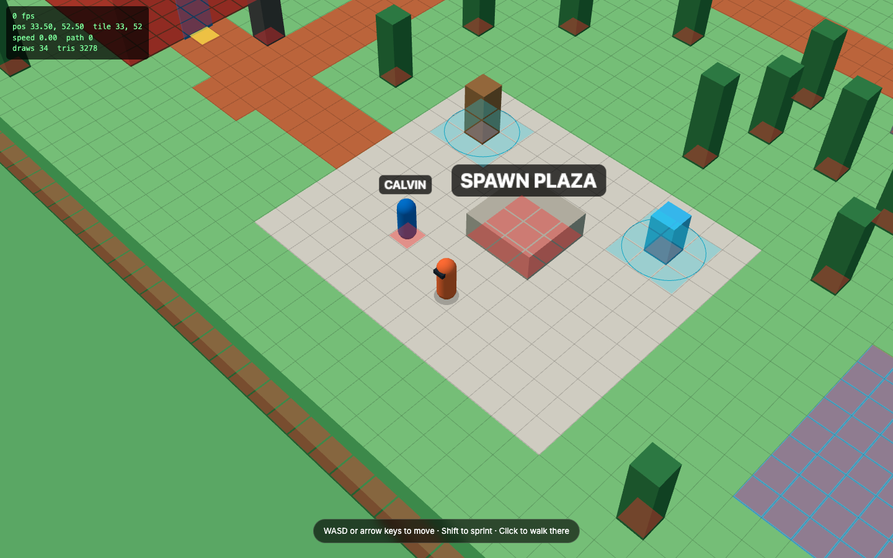 |  |

## M2: Exterior art pass (built, a few items open)

**What's in**
- Third-party files and licenses are logged in `docs/ASSETS.md` (all CC0).
- Asset pipeline (`npm run assets`): one scenery kit GLB (24 Kenney models, 110 KB), four trainers (65 to 73 KB each, about 4,500 triangles, one material), shared animations (118 KB, 6 clips), signage logos (62 KB). 492 KB of models total.
- Exterior art: UCLA (brick, twin towers), Deloitte (glass tower), Meta (white campus, rooftop logo), BetMGM (black and gold, chasing marquee bulbs), Workshop, Blacktop (track, chess tables, bench, trophy case, hoop), Calvin's Court (painted lines, chain-link fence, bleachers), fountain, résumé kiosk, palms, flowers, pond, skyline.
- Sun with soft shadows, sky fill, fog. Quality tiers (high / medium / low) picked on boot, with an automatic step down under 30fps. `?quality=low` forces one.
- Four trainer looks, animated (idle, walk, jog, sprint), sharing one skeleton and one animation file. A look is 8 palette colors, so outfits cost nothing extra to download.
- Loading screen, title screen, character select (arrows, swipe, Enter). The choice is saved, and returning visitors skip the title.
- Résumé button top-right (points at `/classic/` until `/resume` ships in M7).

**Measured**
- Draw calls: about 110 on high and medium, about 46 on low (budget: under 150).
- First playable download: about 0.85 MB uncompressed for JS + models (budget: 3 MB). JS is 192 KB gzipped.
- Tests: 13 unit, 22 smoke (desktop + mobile), including a tour that visits every area.

**Screenshots**

| | |
|---|---|
|  | 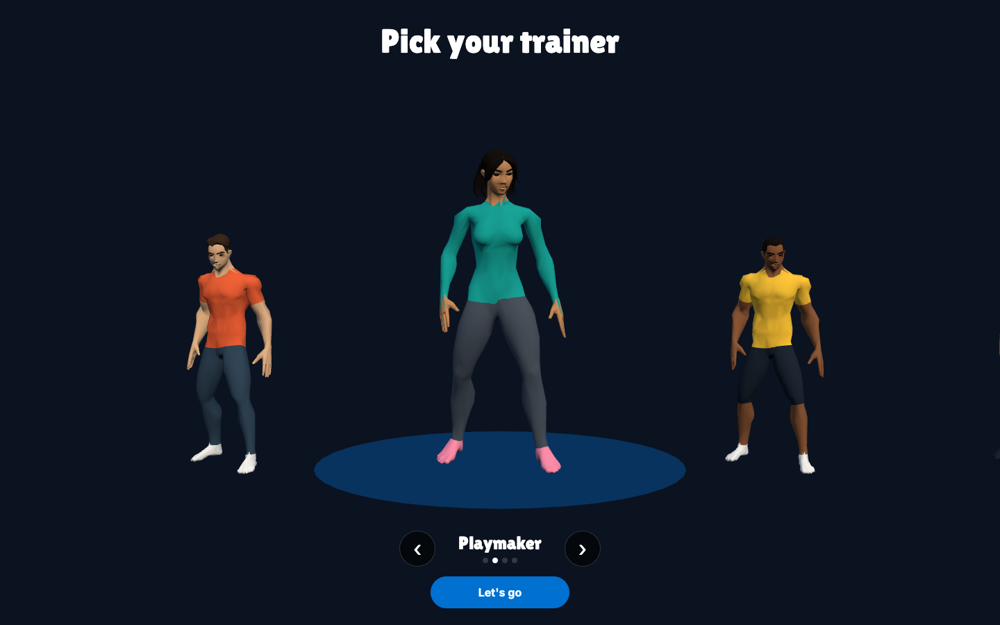 |
| 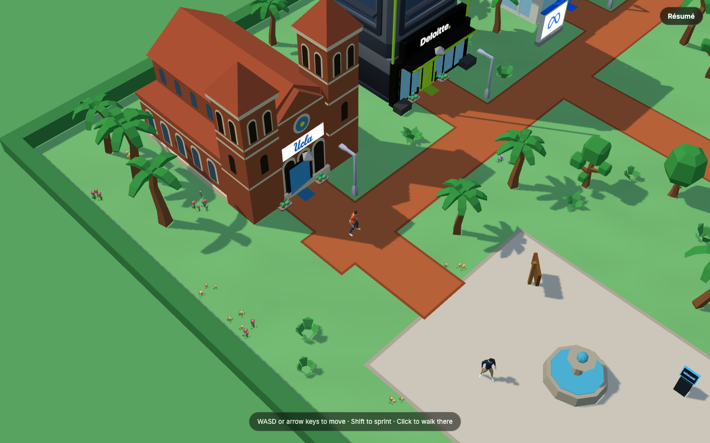 | 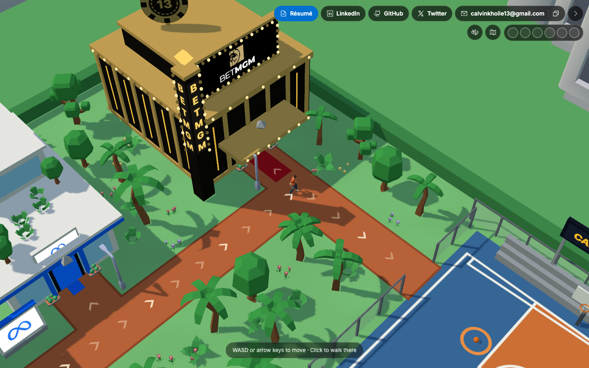 |
|  | 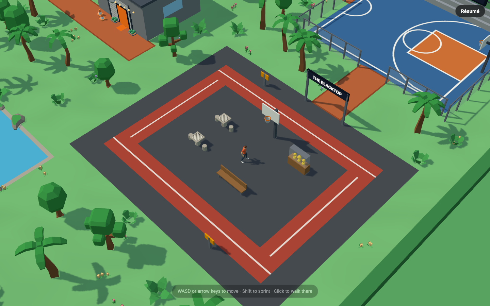 |
|  | 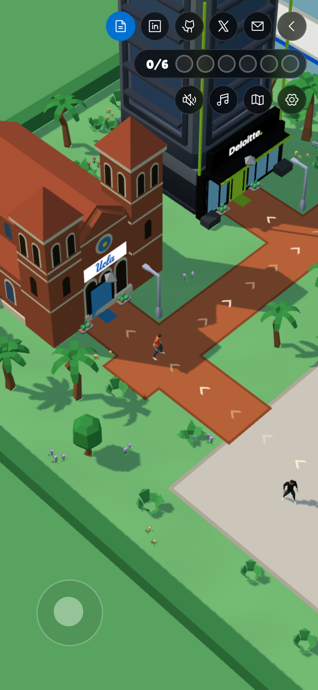 |

**Still open in M2**
- Frame rate on a real phone is unmeasured. Headless tests can't tell us; Calvin's phone can.
- Trainers have bare feet colored as shoes, and the base body is muscular. Real shoes and looser clothes need Blender modeling (planned for the M5 avatar pass).
- Gym exteriors are built in code (plus one Kenney tower), not from kit buildings. After Calvin asked for unique buildings (Nov 15), each got its own architecture: UCLA is Royce Hall (twin belfry towers, banded brick, three-arch portico, rose window, gabled nave), Deloitte is a corporate HQ (glass tower, glazed lobby, wordmark, green light lines), Meta is a tech campus (stacked volumes, roof garden, monument sign), BetMGM is a casino (marquee billboard, pylon sign, giant chip, red carpet, chasing bulbs).
- Stadium lights at the court and path footprint decals are not built.
- Trainer names (Rookie, Playmaker, Sixth Man, Sharpshooter) and loading tips are drafts for Calvin to review.

## M3: Interaction + dialogue + cards ★ (ready for review)

**What's in**
- **Content migrated:** all 11 career entries, bio, side builds, and hobbies now live in `src/content/`, verbatim. 52 card photos optimized to WebP: 79 MB of originals down to 4.4 MB.
- **Proximity prompts:** walk into range and a prompt floats over the thing ("E · Rewards Store" on desktop, "● Rewards Store" on touch). Nearest target in the direction you face wins. Click or tap a target and the player walks over and uses it.
- **Dialogue:** Pokémon-style box with a speaker tab, typewriter text, blinking ▼, and choices. E / Space / Enter / click / the A button advance. Esc skips.
- **Plaza Calvin:** on a first visit he walks up and starts the intro. Choices: "Show me around" (he leads you to the UCLA door), "I'll explore", "Who are you?" (About card with your two bio paragraphs).
- **Project cards:** every screen type from the classic site: before/after slider, side-by-side with zoom spot, single image with zoom spot, swipeable gallery, bullets, timeline, side photo, side gallery, jump links. Tap any photo for the lightbox. Desktop panel, full-screen sheet on phones (swipe the header down to close). Keyboard-usable modal with a focus trap.
- **BetMGM interior:** walk through the door (fade), four stations (Rewards Store counter, server racks, partnership desk with a bellhop cart, AI lab pod), the Product Summit stage showing your photo, and Calvin as gym leader. Rings turn from blue to green with a check when visited, a counter shows "2/4 stations", "Next station →" drops a bouncing arrow on the nearest unvisited one. Progress is saved.
- **Blacktop stations** (outdoors) are wired too: mile markers, chess tables, coach's bench, trophy case.
- Other gym doors say "Still under construction" until M4.

**Tests**
- Vitest: 13 passing. Playwright: 37 passing across desktop and mobile, including a full BetMGM run (enter, all four stations, leader, exit, reload) and a sweep that opens every station's card and checks every image loads.

**Screenshots**

| | |
|---|---|
|  |  |
| 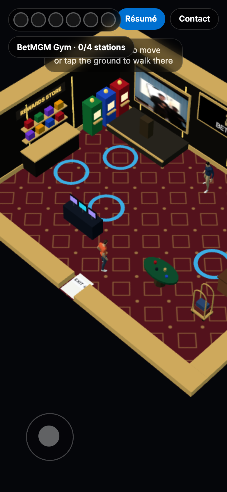 |  |

**For Calvin to review**
1. Dialogue copy: every line is a draft, listed in `docs/CONTENT-EDITING.md`.
2. Cards on your phone: does the before/after slider feel right, and do the zoom spots land where you expect?
3. The BetMGM room: do the four stations read as what they are?

**Deferred from this milestone**
- Hover outline glow on interactables (desktop shows a pointer cursor for now).
- Gym leader outfits per era (every Calvin wears the plaza look until the M5 avatar pass).

### Calvin's M3 review (Nov 15) and what changed

1. **Desktop speed:** keyboard and mouse now always move at 7.5 units/s. No sprint key. Phone speeds are unchanged.
2. **Smaller park:** the map went from 80 x 60 to 52 x 60. Calvin's Court moved next to BetMGM at the top of the main path. The Workshop and the Blacktop merged into **The Weightroom**, one outdoor area between the plaza and the court with five stops: Sportsbook Ticker, Workbench, Sprint Lane (both marathons in one card), Chess Table, Hoop (all of basketball in one card). The second chess table, the coach's bench, the trophy case, the second mile marker, and the Workshop easter egg were cut so the area doesn't read as a brag list.
3. **Cards:**
   - Rewards Store shows its three before/afters together (a row on desktop, a swipeable row on phones) instead of behind tabs.
   - Loyalty APIs: "Account Linking" and "Real-Time Data" are one comparison with lettered A and B spots. Hover, click, or tap a letter to zoom in and swap the caption. Captions are unchanged.
   - Hints tell people what to do: "Drag the slider to compare before and after", "Tap A or B to zoom in".
   - Phone sheet: rounded top with a strip of the world above it, slides up with an iOS-style curve, follows the finger when dragged by the header, and springs back or slides away on release.
   - Photo props (Product Summit, Meta HQ) show smaller, framed, with a caption. The captions are placeholders for Calvin.
4. **Idle hint:** the how-to-move hint hides while moving and returns after 5 seconds of standing still.
5. **A button:** hidden by default on touch. It appears, translucent, only when there is something in range to use or a dialogue to advance.
6. **Dialogue:** shows "Press any key to continue" (desktop) or "Tap to continue" (touch), and any key continues.

### Calvin's second round of feedback (Nov 15) and what changed

1. **Résumé:** every résumé link (HUD button, title screen, loading screen, plaza kiosk, skip link, no-WebGL fallback) now opens his real résumé PDF at `/resume.pdf` instead of the classic site. **The PDF is not committed yet**: it has his phone number on it, and this repo is public, so it stays local (gitignored) until he confirms. See Open issues.
2. **Socials:** LinkedIn, GitHub, Twitter, and Email sit next to the Résumé button, top-right, always visible. Email copies the address and shows a toast, with a `mailto:` fallback. On phones the four fold into a Contact menu.
3. **Trainer select over the park:** the four trainers are drawn on top of the live world instead of a blank stage, so the park stays in view from the title screen through the pick.
4. **Ground arrows:** small chevrons run from the plaza to UCLA, north past every gym, and on to the court, with a short spur into each gym door. They pulse in the direction of travel. The Weightroom has none: it's the detour.
5. **Same speed indoors:** interiors use a closer camera, which made the same world speed look faster. Indoor speed is now scaled by the camera zoom (0.62), so it looks identical on screen.
6. **Smoother, fitted, combined pop-ups:** two or three simple screens (sliders, screenshots, photo sets) now sit side by side with their captions instead of behind tabs. That covers Rewards Store, Platform Enablement, AI at BetMGM, all three Meta projects, and the hobby cards. Images are sized by viewport height so a row fits on screen. Cards ease out on close as well as in, tabs cross-fade, and the phone sheet follows the finger.

### Calvin's third round of feedback (Nov 15) and what changed

1. **A fast way through each gym.** Talking to Calvin in a gym now offers "Walk me through it": every station's card, one after another, inside the pop-up, with "Next: <station> →" and "Finish". Each stop counts as visited and finishing earns the badge. "I'll look around" still opens the overview for exploring on foot.
2. **Tracker moved and made expandable.** The station tracker and the badge case now sit under the résumé and social buttons, top-right. The tracker is collapsed by default. Expanded, it lists each station (tap one to jump there and open it) and has "Skip the walk: see all N", which starts the same walkthrough. It also appears for the Weightroom while the visitor is standing in it.
3. **Pop-ups show one thing.** A station opened on its own shows only that station. The step-through footer appears only in a walkthrough.
4. **Click or tap the thing itself.** Clicking the counter, the whiteboard, the door, or Calvin now walks over and uses it. Before, only the floor ring counted. The prompt bubble is tappable too, so phones no longer depend on the A button.

## M4: All gyms + badges (done)

**What's in**
- **Three more interiors:** UCLA (a campus gym: graduation stage, club fair booths, internship corkboard), Deloitte (an office: three project whiteboards, the sushi bar), Meta (a product floor: feedback kiosk, a giant phone showing Stories, a mailbox, a window with the HQ photo). All four gyms share one room template, so a gym file only lists its theme, furniture, and stations.
- **Gym leaders:** Calvin stands at the back of every gym with three lines of dialogue: a welcome, the badge hand-off once every station is visited, and a follow-up afterwards.
- **Badges:** six of them (Bruin, Consultant, Ship-It, High Roller, Explorer, Park Legend). Earning one plays a ceremony: the badge spins up with confetti and a short buzz on phones. The Explorer badge comes from finishing all five Weightroom stops. Park Legend waits for the finale (M6).
- **Badge case:** six slots top-left. Tap it for the list of badges and how to earn each, plus a two-tap "Reset progress".
- **Door badges:** the floating marker over each gym door turns from grey to the gym's color once its badge is earned.
- **Texts from Calvin:** a toast at two badges and at four, using the lines from the plan.
- **Deep links:** `#/gym/betmgm`, `#/gym/betmgm/rewards-store`, `#/weightroom/chess`, `#/court`. A link skips the title screen and drops the visitor there with the card open. The hash follows the visitor as they walk around and open cards.
- **Save:** look, badges, and visited stations persist. Everything works with storage off.

**Tests**
- Vitest: 21 passing (adds reachability checks for every scene, a check that every station is placed exactly once, and deep-link parsing).
- Playwright: 50 passing across desktop and mobile. New: a full run of UCLA, Deloitte, and Meta ending in each badge, the Weightroom to the Explorer badge, the badge case and reset, deep links, hash sync, the résumé and social buttons, and indoor speed.

**Screenshots**

| | |
|---|---|
| 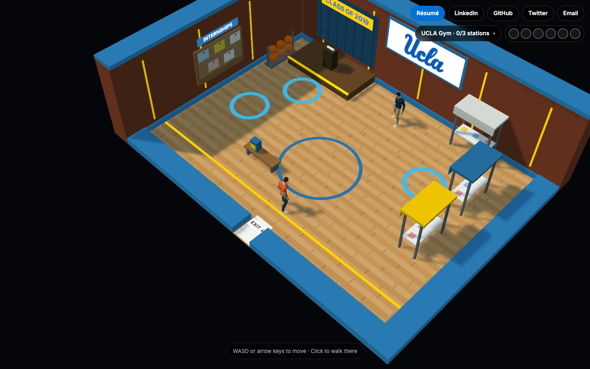 | 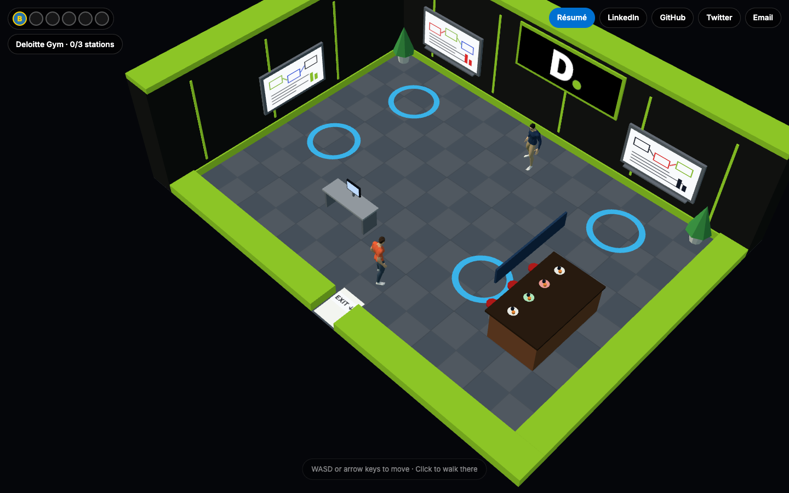 |
| 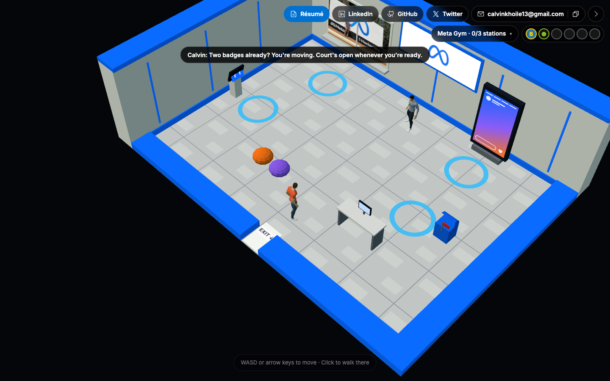 | 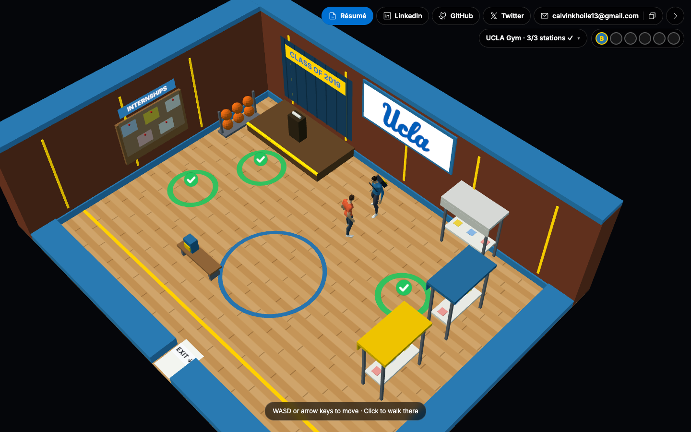 |
| 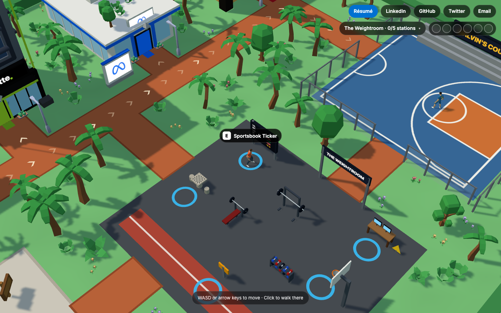 | 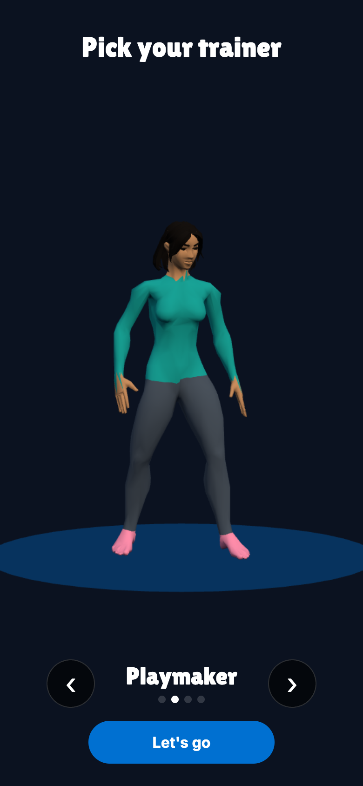 |

### Calvin's fourth round of feedback (Nov 15) and what changed

1. **Résumé PDF committed** (`public/resume.pdf`), at Calvin's say-so.
2. **Quick links are a collapsible bar.** Expanded: icon plus name, and the email is spelled out with a copy icon that turns into a check when copied. Collapsed: icons only. Desktop starts expanded, phones start collapsed, and the choice is remembered. Icons are Phosphor Icons (MIT), inlined.
3. **Deploy workflow builds the new site.** `deploy.yml` on `world` now runs install, unit tests, and the Vite build, and publishes `dist/`. Merging `world` into `main` swaps the live site. (This was planned for M8 and pulled forward because Calvin wants to share.)
4. **Pull request:** not opened by me. Creating one needs GitHub API access with Calvin's credential, which I'm not permitted to use. He can open it from the compare page.
5. **Workbench looks lived in:** two monitors of code, keyboard, mouse, mug, sticky notes, a lamp, and a mesh-back office chair.
6. **Overhead press.** Walk up to the dumbbell rack, E (or tap) to pick them up, G (or the Press button) for a rep, Space (or Put back) to rack them. The arms are posed in code, since the animation library has no press clip.
7. **Mini jet** on a stand east of the court. Its card tells the JetBlue 25 for 25 story in Calvin's words with his screenshot.
8. **Tier B avatar approved.** Waiting on the generated model in `assets-src/calvin/`.

Side effect worth knowing: plain-colored static geometry now merges into one mesh per building using vertex colors. Draw calls dropped from about 150 to about 100.

## M5: Calvin's avatar ★ (ready for review)

**What's in**
- **Tier A Calvin** in six outfits, each worn where it belongs: black jacket at the plaza (from his headshot), blue hoodie and backpack at UCLA, charcoal blazer with a laptop at Deloitte, grey hoodie at Meta, navy quarter-zip with a lanyard at BetMGM, and a #13 jersey at his court.
- Same mesh family and skeleton as the trainers, so every animation is shared. 4,518 triangles. Outfits are palette swaps, so all six cost no extra download. Accessories (backpack, laptop, lanyard, jersey number) are a few small boxes attached to bones.
- **Court Calvin** now stands at the top of the key in the jersey. He has one temporary line until the 1-on-1 is built in M6.
- **Lineup page** for review: `/?lineup=1`, and `/?lineup=1&close=1` for the face.
- **Tier B instructions:** `docs/AVATAR-TIER-B.md`.

**Screenshots**

| Lineup | Close-up |
|---|---|
| 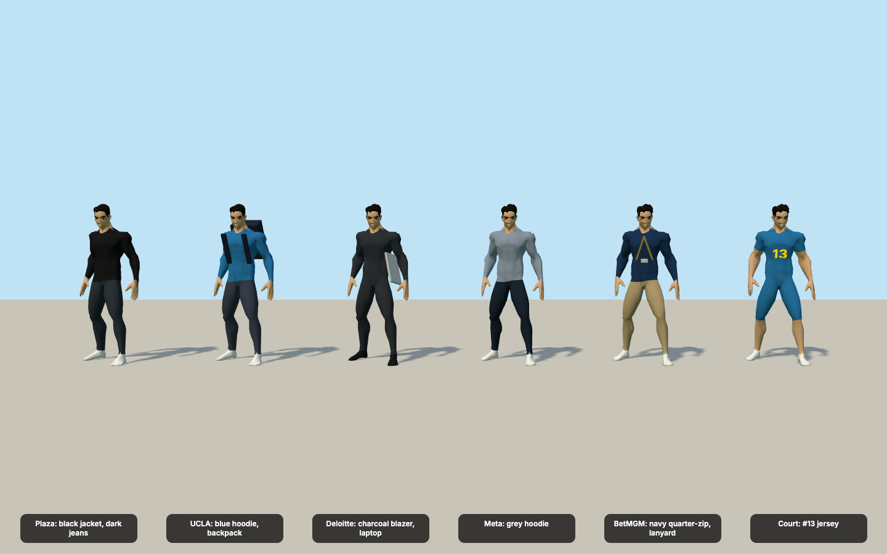 | 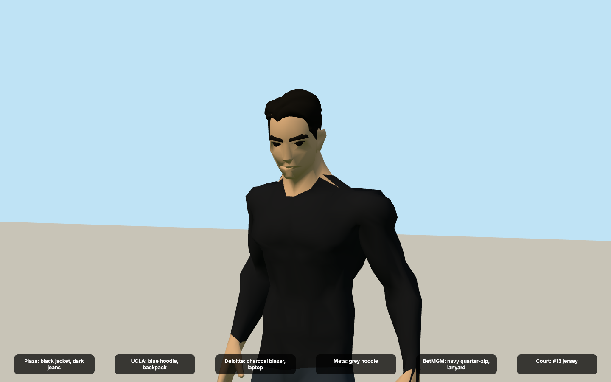 |

**Honest assessment**
- What works: hair (short, black, volume on top), skin tone, and the outfits read correctly from the park's camera distance. The #13 and the lanyard are legible.
- What's weak: the body is the stock muscular base, so hoodies and the blazer look painted on. The face is generic and the heavy brows make him look stern, where the headshot is all smile. Feet are bare with shoe color. Up close it does not look like Calvin specifically.
- Recommendation: Tier B, or a Blender pass on Tier A (slimmer build, softer brows, shoes, a collar). At gameplay distance Tier A is acceptable. In the lineup it is not a likeness.

**Notes**
- The plan asked for one material per character. The body is one material. The accessories add two or three tiny ones.

### Calvin's fifth round of feedback (Nov 15 to 16) and what changed

1. **Keys:** Enter and the right arrow move on everywhere there's a "next": dialogue, the station pop-up, the finale, the badge ceremony. Arrows move between dialogue choices.
2. **Finale answers on one line:** the question card is wider and four answers sit in one row on desktop (two by two on phones).
3. **Chess notation:** the check and mate marks (+ and #) are no longer shown on the answer buttons.
4. **Picking up a basketball is obvious now:** every loose ball on the court has an orange ring and a "Pick up the ball" prompt, the dumbbells got the same ring, and stepping onto the court for the first time shows a hint.
5. **Speed:**
   - The badge case has a jump button for every badge (four gyms, the Weightroom, the court).
   - Talking to Calvin in a gym leads with **Finish this gym**, which marks it done and awards the badge on the spot. His welcome is one line, so the choices are there right away. The tracker has the same button.
   - **"I'll look around"** now just closes (it used to open the overview card).
6. **One pop-up per place.** A station's pop-up shows that station and carries a strip of every stop in the gym, with a check on the ones seen. Tap another stop in the strip, or "Next", and the pop-up swaps in place. Close it after seeing them all (Finish, X, or a click outside) and the badge is awarded right there. UCLA's three stations each show only their own part.
7. **The workbench is scenery.** No ring, no prompt, no card. The Weightroom has four stops. The "Building with AI" copy is still in `src/content/side-builds.ts` but nothing in the world shows it now.
8. **Phones swipe photo sets.** Galleries are native scroll strips: no arrows on phones, the next photo peeks in, dots follow.
9. **Sushi bar line** says "March 2020".

## M6: Finale ★ (ready for review)

**What's in**
- **The challenge:** talk to Calvin at his court (in the #13 jersey). "Run it" starts the game, "Not yet" backs out.
- **Game mode:** the camera moves in on the court, the HUD clears, and a pixel-font scoreboard shows YOU, CALVIN, and the possession.
- **Five possessions**, each a question. Right answer: the visitor drives and scores (or pulls up from deep on a 3-point question). Wrong answer: Calvin blocks the shot, then buries one for the same points. The question card ducks away while the play runs, then returns with the verdict, the explanation, and Calvin's line.
- **Four question types:** a chess board built from a FEN string (the winning move slides across the board on reveal), a half-court diagram with Os and Xs (tap a teammate or use the buttons, and the pass is drawn on reveal), multiple choice (with an odds board for line shopping), and the Rivalry Round (three matchups in team colors, all three needed, revealed one at a time).
- **Draw rules:** possessions 1 to 4 come from chess, hoops, points, and betting with at least one chess and one hoops, at most two per category, and no repeats from the last game. Possession 5 is always the Rivalry Round. Options are shuffled every draw.
- **Ties** go to one sudden-death possession.
- **Result screen:** "You beat Calvin." or "Calvin wins, 6-4.", "You answered N/5", Calvin's line, LinkedIn / Email / Twitter, Share your score (native share sheet on phones, copied elsewhere), Run it back, Back to the park. A win earns the Park Legend badge first.
- **Shootaround:** loose balls sit on the court. Pick one up, press G (or the Shoot button) to put up shots, Space (or Put back) to stop. It keeps a "3 for 5" tally.
- **Court turned:** the hoop now stands at the north end under the "Calvin's Court" board, facing the camera.

**Tests**
- Vitest: 50 passing. Every question is checked against the schema. Every chess position is checked with chess.js: legal position, every option a legal move, the answer the only mate (or the only fork) among the options, and the "Qd1 mate" detail in the fork explanation. Draw rules are checked across 200 seeded draws, plus the tie case.
- Playwright: 78 passing. Win, loss with Run it back, tie into sudden death, the animations with motion on, a keyboard-only game, a seeded normal draw, and the shootaround.

**Screenshots**

| | |
|---|---|
| 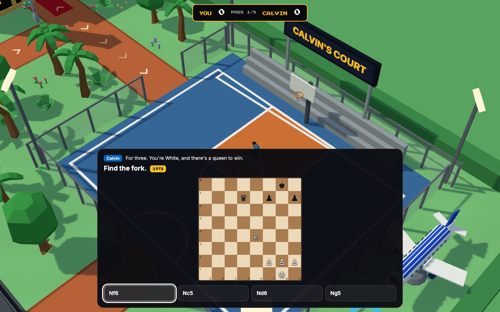 | 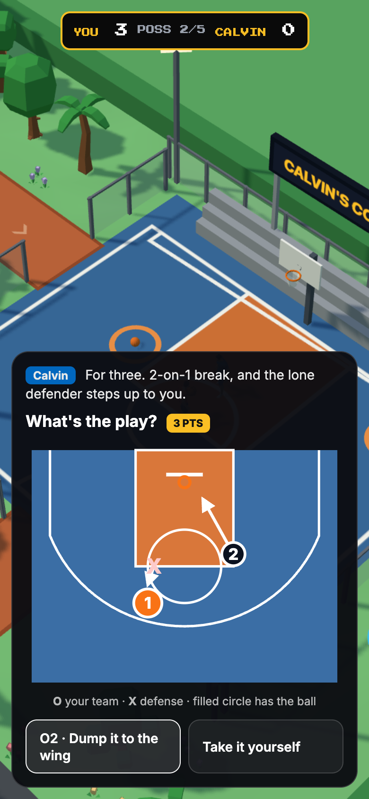 |
| 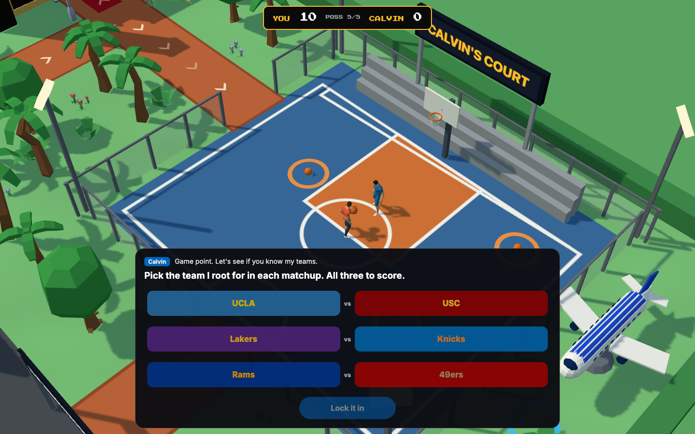 | 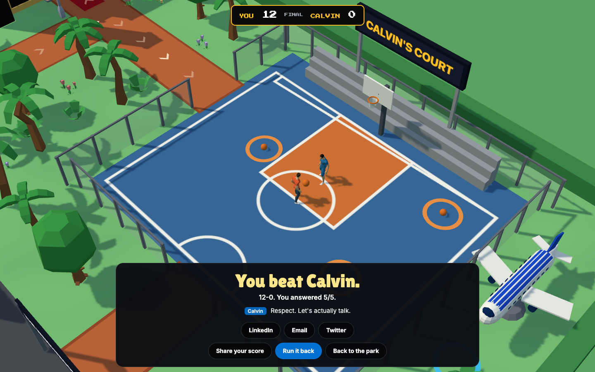 |
| 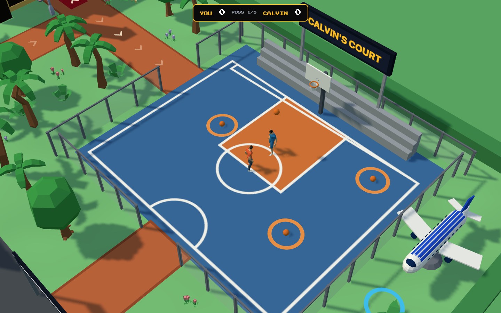 | 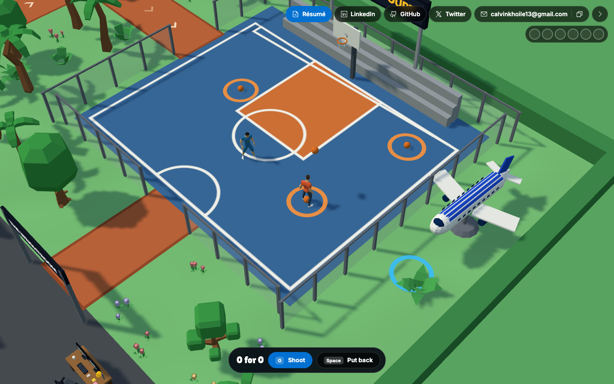 |

**For Calvin to review**
1. All 15 questions: `src/content/finale-questions.json`, listed in `docs/CONTENT-EDITING.md`. Chess is machine-checked. The four basketball diagrams, the points and betting answers, and every Calvin line need your eye.
2. Whether a wrong answer should cost the same points it would have earned (it does now, per the plan).

**Deviations**
- No broadcast-angle camera, crowd, or stadium lights. The camera zooms in on the same isometric angle. Sound is M7.
- `?seed=` and `?set=` work in every build, not just debug builds, because the tests run against the production build. They change nothing unless typed into the URL.
- Chess pieces are Unicode symbols, so there is no piece-set license to track.

## M7: Polish (built)

**What's in**
- **Sound effects**, off by default, never autoplayed. A speaker button next to the badge case turns them on (that click is also what browsers require before audio can play). Footsteps change with the surface (grass, hard ground, indoor carpet), plus blips for interacting and advancing dialogue, a whoosh for doors, pop-up open and close, the badge fanfare, right and wrong in the 1-on-1, and swish or rim in the shootaround. 18 files, 136 KB, all Kenney (CC0). The audio library loads only when sound is first switched on.
- **Minimap:** M on a keyboard, or the map button. A top-down sketch of the park with labels and the visitor's position and heading. Outdoors only.
- **Accessibility audit:** axe-core runs in the browser tests against the title screen, character select, HUD, tracker, badge case, dialogue, every kind of station pop-up, every finale question type, and the result screen. Zero serious or critical violations. Three real problems were found and fixed: clickable players inside a diagram marked as an image, a link nested inside the loading progress bar, and photo strips that couldn't be reached by keyboard.
- **Sharing and search:** Open Graph and Twitter card tags, a 1200 x 630 preview image of the park (`public/og.png`, captured by a test), a canonical URL, `sitemap.xml`, and `robots.txt`.
- **Slow devices:** if a device is already on the lowest quality tier and still under 20 frames a second, a screen offers the résumé and the classic site, with "Keep going anyway". No WebGL at all shows the same screen without that button.
- Already in from earlier milestones: haptics on interact and badges, reduced-motion handling (no camera lead, no confetti, instant fades, court animations skipped), and the no-JavaScript message.

**Added in the second M7 pass (Nov 16)**
- **Music:** a slow lo-fi loop generated in the browser with Web Audio (soft chords and plucked notes), so there is nothing to download or license. Each gym plays in its own key, and the 1-on-1 picks up the tempo with a bass pulse. Off by default, with its own button. It's a placeholder: a real track can replace it.
- **Settings menu** (gear button): sound effects, music, a volume slider, graphics quality (Auto, High, Medium, Low, remembered), and reset progress.
- **Sound on older iPhones:** every effect now has an AAC copy that plays first, with Ogg as the fallback. `scripts/audio-aac.mjs` regenerates them (it decodes in a headless browser and encodes with macOS's `afconvert`, since `ffmpeg` isn't installed).
- **Hover highlight:** on desktop, the ring of whatever the pointer is over turns white.
- **Court lights:** four stadium lights on the court's corners switch on as the visitor approaches.

**Not done**
- **A real music track.** The generated loop is pleasant but simple. Swap in a CC0 or licensed track when there is one.
- **A generated `/resume` page.** Dropped when Calvin chose the PDF. A PDF is less accessible than HTML, so screen-reader users get the PDF and the classic site rather than a purpose-built page.
- **Finale atmosphere:** no broadcast-angle camera or crowd.

---

## M7.5: Motion, feel, and review fixes ★ (ready for review)

Calvin asked for a polish milestone after M7: smooth, animated transitions everywhere, better basketball, and a full mobile + desktop review.

- **Motion.** One enter/leave helper (`src/ui/motion.ts`). Every overlay now animates out instead of vanishing. Dialogue opens and closes like an old TV (dot, scanline, box). Doors close and open as an iris on the player. Cards ease in and out, and the camera eases its zoom.
- **Phone sheet.** Drag down from anywhere (once scrolled to the top) to dismiss. Short cards size to their content. Sideways swipe changes station. The header folds to one line on scroll. Short landscape screens get the sheet too. Before/after rows stack.
- **Basketball.**
  - Shootaround: real jump shots with a 2K-style hold-and-release meter (green release always falls), streaks (HEATING UP, ON FIRE), and rebounds back to the shooter.
  - 1-on-1: possessions play as a step-back three, a crossover dunk, a Euro step, or Calvin's block and pull-up, with callouts and screen shake. The game ends with one last play: a layup on Calvin, or a block.
- **Weightroom.** Curl (G) and overhead press (H).
- **Loading screen.** Sunset over the park's skyline, a dribbling ball, live percentage, résumé button.
- **Review fixes.** The two review agents' main findings, fixed:
  - slow-device screen no longer interrupts a session;
  - keyboard: lightbox and gallery arrows, tabs, focus traps;
  - touch: focus rings, tap targets, badge count and named jump buttons;
  - result-screen Résumé button and "Show me your latest work" intro shortcut;
  - Meta logo on Safari (the SVG had no size).
- **Calvin's calls (Nov 17):**
  - The AI at BetMGM screenshots are now blurred: internal links, names, faces, repo path and repo stats. This also covers the unused `team-os.webp`.
  - The station names stay as they are.
  - "Walk me through it" is now the first gym leader choice, followed by "Skip to the badge".
  - "nostalgic" is fixed.

## Decisions and deviations from the plan

Defaults I picked where the plan was ambiguous or didn't fit. Flag any you want reversed.

| Topic | Plan said | What I did | Why |
|---|---|---|---|
| Vitest version | Vitest (unpinned) with Vite 5 | Vitest 3.2.7 | Vitest 5 requires Vite 6+. 3.2.7 is the newest line that supports Vite 5 |
| TypeScript version | TypeScript (strict) | 5.9.3, not 7.x | 7 is a new major. 5.9 is the safe choice with the rest of the toolchain |
| three.js version | r165+, pinned | 0.187.0 for the world. Classic keeps 0.165.0 from its CDN import map | Classic is frozen as-is |
| Classic asset paths | "Fix its asset paths to `/classic/assets/...` or a shared `/images/`" | Moved `assets/` to `public/classic/assets/`. Classic's relative paths work with zero edits | The classic files stay byte-identical. The world gets its own optimized copies in `public/images/` at M3 |
| Joystick | nipplejs or custom; spawns where the thumb lands | Custom (in `src/engine/input.ts`), fixed position | One less dependency. Calvin preferred a fixed stick after testing on his phone |
| Tap-to-move speed | Not specified | Walks, auto-sprints when the trip is over 12 units | Crossing an 80-tile map at walk speed by tap is a slog |
| Camera tuning | Fixed 45° yaw | 45° default, plus `?yaw=` and `?zoom=` knobs | So the M1 feel review can compare options without a rebuild |
| Pond | "hedges, water, or fences" at edges | Added a small pond east of the plaza | Fills the empty south-middle. Easy to cut |
| Skip link | "Skip to résumé" | Points at `/classic/` for now | `/resume` doesn't exist until M7 |
| `.nojekyll` | Include in the artifact | Included, with `include-hidden-files: true` | `upload-pages-artifact` v4+ drops dotfiles by default |
| Before/after | "A before/after comparison slider" | Built as a slider (the classic site shows the two side by side) | The plan asked for it, and each before/after pair has matching dimensions, so the overlay lines up |
| Gym doors | Interact to enter | Walking onto the door tile enters, and so does the prompt | Feels like a Pokémon door. The prompt is there for click/tap and keyboard users |
| Map size and areas | 80 x 60 with a separate Workshop interior and Blacktop | 52 x 60 with one outdoor Weightroom | Calvin's call after M3: the court was too far and the side areas were easy to miss |
| Workshop easter egg | "You are here" diorama | Cut | Fewer stops in the Weightroom, at Calvin's request |
| Résumé | `/resume`: an HTML page generated from the content files (M7) | Calvin's real résumé PDF at `/resume.pdf` | Calvin's call (Nov 15). The generated page is dropped unless he wants both. Note: a PDF is less accessible than HTML, so the plan's "résumé view is the accessible version" no longer holds |
| HUD socials | Icon buttons | Text buttons (LinkedIn, GitHub, Twitter, Email) | Clear without hand-drawn brand icons. Easy to swap for icons later |
| Character select | Rotating models on their own screen | Drawn over the live park | Calvin's call: keep the world in view so people don't bail |
| Deep-link visitors | Default look | Default look, and nothing is saved until they pick one | A shared link shouldn't lock a look in for the next real visit |
| `deploy.yml` on `world` | Changed to build + `dist/` at M8 | Left as the M0 version for now | It only triggers on `main`, so it's inert here. Swapped at M8 as planned |

## Launch notes (M8)

- **Live site:** https://calvinkhoile.github.io is MyPark as of PR #1, which contains everything through M6. Verified after the deploy: the world loads, `/resume.pdf` and `/classic/` are served, and `/CLAUDE.md` and `/docs/` return 404.
- **Not live yet:** the one-pop-up-per-place change, Finish and jump shortcuts, keyboard advance, swipeable galleries, the workbench as scenery, and all of M7 (sound, minimap, accessibility fixes, the social preview image and tags). They are on `world`, CI is green, and they go live with the next merge to `main`.
- **Rollback:** revert the merge commit on `main`.
- **Still to do before calling it v1.0:** Calvin's pass on a real iPhone and Android phone, the Tier B avatar, music (needs a track), and the `v1.0` tag.

## Open issues

- **LAN preview not verified from this laptop.** The dev server listens on all interfaces, but a connection from the laptop to its own LAN IP times out (CrowdStrike, FortiClient, and Tailscale network extensions are installed). Calvin has been testing on his phone, so it reaches him.
- **Running tests locally:** stop the dev server first if the machine is busy. Each test page renders WebGL in software, and Playwright is capped at three workers for that reason.
